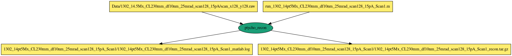
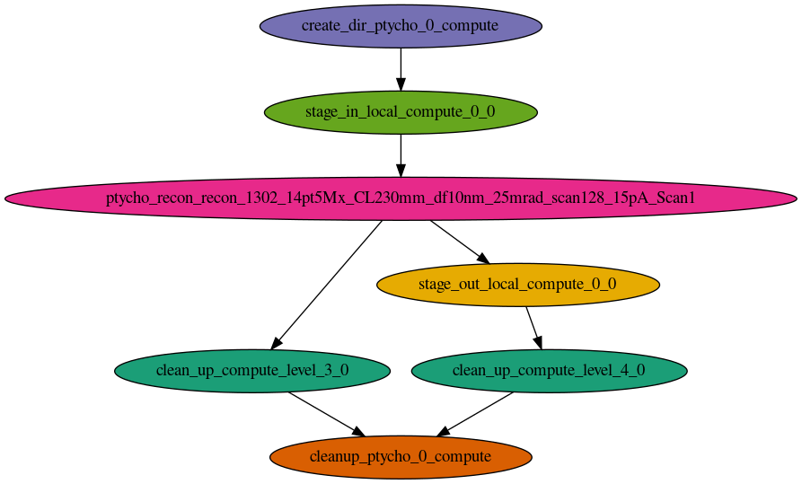

# Ptycho Pegasus Workflow

A [Pegasus WMS](https://pegasus.isi.edu/) workflow for batch electron
ptychography reconstruction with [fold_slice](https://github.com/yijiang1/fold_slice)
(PtychoShelves). It replaces `param_config_multislice.py` and the per-scan
`sbatch` routine. Every scan in an experiment folder that has a row in
`Ptycho parameters.xlsx` becomes one GPU job. Pegasus stages the data, runs
the reconstructions in parallel, retries failures, and brings the results back.

## Pipeline Overview

```
MATLAB templates ─┐   app/build_app.sh (once, MATLAB Compiler)
fold_slice ───────┴──> app/build/ptycho_recon_app

Ptycho parameters.xlsx ─┐   workflow_generator.py
rbf.xlsx ───────────────┼──> (generation time) ──> Params/<scan>_Scan<n>.json
scan folders ───────────┘
                                        │   (workflow, MATLAB Runtime container)
        ┌───────────────────────────────┤
        ├── ptycho_recon(scan A, GPU) ──> <scan A>_recon.tar.gz, <scan A>_matlab.log
        ├── ptycho_recon(scan B, GPU) ──> ...
        └── ptycho_recon(scan N, GPU) ──> ...
```

`workflow_generator.py` follows `param_config_multislice.py` step for step.
It uses the same lookup functions (`get_rbf`, `get_ADU`, `get_alpha0`,
`get_scan_step_size`) and the same loop over scan folders and sheet rows.
Where `param_config` wrote each scan's values into a copy of the template, the
generator writes them into a parameter file, `Params/<scan>_Scan<n>.json`.
Where the old script added a line to an sbatch file, the generator adds a
Pegasus job. The jobs are independent, exactly like the old per-scan `srun`
lines.

The jobs run no MATLAB. The templates and fold_slice are compiled once into a
standalone app (`app/build_app.sh`), which each job runs on its parameter file
in the MATLAB Runtime container (`container/apptainer.def`). The jobs need
neither a MATLAB license nor a MATLAB install on the workers.

| Step | Tool | Description |
|------|------|-------------|
| ptycho_recon | compiled app in the MATLAB Runtime container, 1 GPU | Lays out the staged inputs as the template expects, runs `ptycho_recon_app <scan>.json`, and packs `Recon_result/` into a tarball. |

### Workflow graphs

The abstract workflow for one scan, with its files. The scan's inputs go in,
and the MATLAB log and the `Recon_result/` tarball come out. (These graphs are
from before the container: the job's inputs are now the compiled app, the
parameter file and the raw file. Redraw them with the commands below.)



The executable workflow that `pegasus-plan` builds from it for site
`compute`. Pegasus adds the job that creates the scratch directory, the
stage-in and stage-out of the files, and the cleanup jobs around the
reconstruction:



Both are drawn with `pegasus-graphviz`, which calls Graphviz `dot` for a
`.png` output:

```bash
pegasus-graphviz --files -o images/ptycho-abstract-files.png workflow.yml
pegasus-graphviz -o images/ptycho-concrete.png submit/<user>/pegasus/ptycho/runNNNN/ptycho-0.dag
```

## Directory Structure

```
pegasus-ptycho/
├── workflow_generator.py        # Pegasus workflow generator (param_config logic + catalogs)
├── ptycho_params.py             # Per-scan template variables: parameter files, app sources
├── bin/
│   └── ptycho_recon.py          # GPU reconstruction wrapper (runs in the container)
├── app/
│   ├── ptycho_recon_app.m       # Entry point of the compiled app
│   └── build_app.sh             # Compiles the templates + fold_slice (mcc)
├── container/
│   ├── apptainer.def            # MATLAB Runtime image
│   └── build.sh
├── templates/
│   ├── Ptychography_reconstruction_multislice_template.m
│   └── Ptychography_reconstruction_singleslice_template.m
├── config/
│   └── rbf.xlsx                 # rbf calibration (voltage, camera length, conv. angle)
├── images/                      # Workflow graphs shown in this README
├── run_manual.sh                # Local test
└── README.md
```

## Prerequisites

- [Pegasus WMS](https://pegasus.isi.edu/) >= 5.1.3 and [HTCondor](https://htcondor.org/) >= 10.2 on the submit host. 5.1.3 is the first release with [hosted site catalogs](https://pegasus.isi.edu/docs/5.1.3/reference-guide/catalogs.html#centrally-hosted-site-catalogs) and job tagging. The planner also needs outbound HTTPS to GitHub.
- Python 3.8+ with `pandas` and `openpyxl` on the submit host (the generator reads the `.xlsx` files)
- A compute resource described by one of the hosted site catalogs (an HTCondor pool or a SLURM cluster), with GPUs. On the GPU workers:
  - Apptainer, and an NVIDIA driver for CUDA 12.2 (>= 525)
  - the MATLAB Runtime image on a filesystem they share (see below)
- To build the app, once: MATLAB with the MATLAB Compiler and the Parallel
  Computing Toolbox, of the release of the Runtime in the image (R2025b), and
  a fold_slice checkout whose GPU MEX files are built for that release

## Build the app and the image

Both are built once, and again only when the templates, fold_slice or the
MATLAB release change. The app and the image must be of the same MATLAB
release.

1. **The image** (`container/apptainer.def`): the MATLAB Runtime on Rocky 8.
   It ships the CUDA libraries MATLAB uses; the driver comes from the host.
   ```bash
   cd container && ./build.sh      # matlab-runtime-R2025b.sif
   cp matlab-runtime-R2025b.sif /project/<group>/
   ```
2. **The app** (`app/build_app.sh`), on a machine with MATLAB and the MATLAB
   Compiler (on USC CARC a compute node; MATLAB crashes on the login nodes):
   ```bash
   module load matlab/2025b
   app/build_app.sh /path/to/fold_slice     # app/build/ptycho_recon_app
   ```
   `ptycho_params.py` first turns each template into a script that reads the
   per-scan values from the parameter file (see "How the template is adapted
   to Pegasus"). mcc then compiles them with fold_slice into one app for both
   modes. fold_slice's GPU MEX files are copied into the app as they are, so
   build them for this release first (`mexcuda`). Check
   `app/build/mccExcludedFiles.log` for fold_slice files mcc left out; a
   function that is missing at run time fails with "Undefined function", and
   its folder is then added with another `-a` in `build_app.sh`.

## Prepare the experiment folder

The layout is the one `param_config_multislice.py` expects, with scan folders
directly inside the experiment folder:

```
<experiment>/
├── Ptycho parameters.xlsx
├── Background subtraction.mat          # needed if any row has background subtraction = 1
├── Recon_files/<scan folder>/*.mat     # only for rows with "Previous initial probe" = 1
├── 1302_14.5Mx_CL230mm_df10nm_25mrad_scan128_15pA/
│   └── scan_x128_y128.raw
└── 1305_.../
    └── scan_x128_y128.raw
```

- **Scan folders** are the sub-folders whose name starts with the acquisition
  time (`1302_...`). Each is matched to the sheet rows with the same
  *Acqu. Time*. If several rows share a time, they become `Scan1`, `Scan2`, ...
- **Skipped scans.** As in `param_config`, problems are printed and the scan
  is skipped. Examples: no sheet row, an unknown voltage / camera length /
  convergence angle, an empty scan size, a missing raw file, or
  no background file (`<experiment>/Background subtraction.mat`, or
  `--bg-file`) for a row that needs it.
- **Sheet layout.** The current 28-column sheets have no multislice columns.
  In multislice mode, `previous_object`, `regularization`, `thickness` and
  `Nlayers` then come from `MULTISLICE_DEFAULTS` at the top of
  `workflow_generator.py`. A 32-column sheet with those four columns after
  *Previous initial probe* is read directly.

## Settings

As with `code_dir` in `param_config` and the partition and time settings in
the old submit script, the settings that rarely change are constants at the
top of `workflow_generator.py`:

| Constant | Default | Meaning |
|----------|---------|---------|
| `RBF_XLSX` | `config/rbf.xlsx` | rbf calibration table |
| `APP` | `app/build/ptycho_recon_app` | Compiled app (default of `--app`) |
| `RECON_RESOURCES` | 40 GB, 4 cores, 1 GPU, 14400 s | Per recon job, as in the old sbatch file |
| `RECON_TAG` | `gpu` | Job tag that selects the hosted catalog's GPU profiles |
| `MULTISLICE_DEFAULTS` | `0`, `0.1`, `13`, `2` | previous_object, regularization, thickness, Nlayers |

The templates per `--mode`, and the template variables set per scan, are in
`ptycho_params.py`.

### The container

`ptycho_recon` runs in the image given with `--container-image`, an absolute
path on the workers' shared filesystem:

- **Linked, not copied.** The generator sets `pegasus.transfer.links = true`,
  so PegasusLite symlinks the image into each job directory instead of copying
  several GB per job. The job's input files are still copied, as the container
  sees only the job directory (mounted at `/srv`).
- **GPU.** Pegasus adds `--nv` to `apptainer exec` itself, as the job requests
  a GPU.
- **No job environment script.** Nothing is loaded on the worker:
  `job-env-setup.sh` is not used any more. The container's `%environment` puts
  the MATLAB Runtime on `LD_LIBRARY_PATH`, and the wrapper sets
  `MCR_CACHE_ROOT` to the job directory, where the Runtime unpacks the app.

## Execution site: hosted site catalogs

The execution site is not described in this repository. Pegasus'
[centrally hosted site catalogs](https://pegasus.isi.edu/docs/5.1.3/reference-guide/catalogs.html#centrally-hosted-site-catalogs)
provide it:

- `--site-catalog-file` sets `pegasus.catalog.site.repo.file`. At plan time,
  the planner downloads that file from
  [pegasushub/pegasus-site-catalogs](https://github.com/pegasushub/pegasus-site-catalogs/tree/main/conf),
  from the branch matching its major.minor version (e.g. `6.0`).
- Jobs are planned for the site named **`compute`**.
- The local `sites.yml` describes only the submit host (`local`: `scratch/`
  and `output/`). Pegasus merges it over the downloaded catalog.
- Recon jobs are tagged `gpu`, so a catalog's GPU `x-tags` (e.g. a `gpu`
  queue) apply. Several catalogs read `${RESOURCE_PROJECT}` from the
  environment when planning.

| Hosted file | Resource |
|-------------|----------|
| `access-pegasus.yml`, `access-pegasus-expanse.yml` | ACCESS Pegasus (HTCondor glideins) |
| `ospool-ap40.yml`, `ospool-ap41.yml` | OSPool access points |
| `usc-discovery.yml`, `usc-laguna.yml`, `unity.yml`, `purdue-anvil.yml` | SLURM clusters (direct submission) |
| `nersc-perlmutter.yml` | NERSC Perlmutter (SFAPI) |

**The app** is staged to each job like any other input. fold_slice is
compiled into it, so no fold_slice checkout is needed on the workers.

## Usage

### Generate the workflow

```bash
export RESOURCE_PROJECT=myalloc
./workflow_generator.py \
    --data-dir "/scratch/zhangych/Data/20230805_WSe2_EMPAD/" \
    --site-catalog-file usc-discovery.yml \
    --container-image /project/<group>/matlab-runtime-R2025b.sif \
    --mode multislice
```

`RESOURCE_PROJECT` is read by several hosted catalogs when planning, e.g. the
SLURM account on USC Discovery.

This writes `workflow.yml` and the catalogs to the current directory, and the
parameter files to `Params/` next to the generator. Check them before
planning, as you would the old `Scripts/` folder.

### CLI options

| Option | Default | Description |
|--------|---------|-------------|
| `--data-dir` | (required) | Experiment folder |
| `--site-catalog-file` | (required) | Hosted site catalog file name, e.g. `access-pegasus.yml` |
| `--container-image` | (required) | MATLAB Runtime image on the workers' shared filesystem (absolute path) |
| `--app` | `app/build/ptycho_recon_app` | Compiled app, from `app/build_app.sh` |
| `--bg-file` | `<data-dir>/Background subtraction.mat` | Background file for rows with background subtraction = 1 |
| `--mode` | `multislice` | `multislice` or `singleslice` template |
| `-e`, `--execution-site-name` | `compute` | Execution site name |
| `-s`, `--skip-sites-catalog` | off | Don't write the local `sites.yml` |
| `-o`, `--output` | `workflow.yml` | Output workflow file |

### Plan and submit

```bash
pegasus-plan --submit --dir submit --sites compute --output-sites local workflow.yml
```

### Monitor

```bash
pegasus-status -l submit/$USER/pegasus/ptycho/run0001
pegasus-analyzer submit/$USER/pegasus/ptycho/run0001    # on failure
pegasus-statistics submit/$USER/pegasus/ptycho/run0001
```

When a recon job fails, `pegasus-analyzer` shows the last 60 lines of the
MATLAB log.

## Outputs

Final outputs are staged to `output/`:

| Output | Description |
|--------|-------------|
| `<scan>_Scan<n>/<scan>_Scan<n>_recon.tar.gz` | The `Recon_result/` tree: `init_probe_*.mat`, `*_params.mat`, the `Reduced_run_*` / `Full_run_*` iterations, and the scan's parameter file. |
| `<scan>_Scan<n>/<scan>_Scan<n>_matlab.log` | The app's stdout/stderr (the old `Log/Data_<scan>.txt`). |

The intermediate `data_roi*_dp.hdf5` (the prepared diffraction data, about the
size of the raw file) is left out of the tarball and stays on the worker.

**Failed reconstructions fail the job.** PtychoShelves catches its own errors,
prints `Reconstruction stopped!` and lets the app exit 0. `ptycho_recon.py`
therefore also fails the job when the MATLAB log contains that line or no
`*Niter<N>.mat` (e.g. `Full_run_Ndp_128Niter2000.mat`) was written, and prints the end of the log to stderr (see
`pegasus-analyzer`). With `dagman.retry = 1` the job is retried once.

**Outputs of a failed job.** The tarball (whatever `Recon_result/` holds) and
the MATLAB log are written even when the job fails. HTCondor returns them to
the workflow's scratch directory on the submit host,
`scratch/<user>/pegasus/ptycho/runNNNN/<scan>_Scan<n>/`, but Pegasus does not
stage a failed job's outputs to `output/`. A retry overwrites them.

## How the template is adapted to Pegasus

A compiled app cannot run a copy of the template with the values written in,
so the templates are compiled once, reading the values at run time.
`app/build_app.sh` has `ptycho_params.py` turn each template into
`ptycho_recon_<mode>.m`:

- every line that sets a per-scan variable, `<var> = <value>;`, becomes
  `<var> = P.<var>;`, of the same type (`string(...)` for `"..."`, `char(...)`
  for `'...'`). `P` is the parameter file, read by `app/ptycho_recon_app.m`,
  which then runs `ptycho_recon_<mode>` in its workspace;
- the `addpath` lines run only outside the compiled app (`~isdeployed`), as
  fold_slice is compiled in;
- `clear;clc;` is removed, as it would clear `P`.

Pegasus runs each job in its own scratch directory, so `exp_dir` cannot be a
fixed path: the app sets it to the directory it runs in, the job directory.
`ptycho_matlab_path` points at fold_slice's `ptycho/` folder inside the app
(and `cSAXS_matlab_path` at the folder above): besides calling its functions,
fold_slice lists its own folders, e.g. `+detector/+prep_data` for the
detector functions. The app finds that folder with `which` and prints it to
the log.

The raw file is registered as a **deep LFN**,
`Data/<scan folder>/scan_xN_yN.raw`. That is the path the template reads
(`<exp_dir>/Data/<data_dir>/`), so Pegasus places the file exactly there in
each job directory. It also keeps raw files from different scans apart even
though they share a file name. Sheet rows that share an acquisition time
(`Scan1`, `Scan2`) use the same raw file. The `Data/` prefix comes from the
template; the experiment folder itself needn't have a `Data/` sub-folder.

Before starting the app, the wrapper links the other staged inputs to the
paths the template reads: `Background subtraction.mat` and
`Recon_files/<scan folder>/init_recon.mat`.
One line of Step 4 is changed in both templates: `save_dir` is under
`result_path` instead of `base_path`. The templates write the prepared
diffraction data (`Scan_<n>/data_roi*_dp.hdf5`) and set `p.hdf5_path` for a
modified fold_slice; upstream
[fold_slice](https://github.com/yijiang1/fold_slice) reads it from
`p.base_path` (= `result_path`) instead (`scans.get_filenames_cu`), and with
the original line fails with `Failed to load dp from …`.
Nothing else in the templates was changed. As in `param_config`, the values
are passed exactly as written in the sheet; an empty cell becomes `NaN`.

## Testing locally

```bash
./run_manual.sh --data-dir "/scratch/zhangych/Data/20230805_WSe2_EMPAD/" --scan 1302
```

This generates the workflow and writes the parameter files, and runs
anywhere. To also run the reconstruction, run it on a GPU node with Apptainer
and add `--image /path/to/matlab-runtime-R2025b.sif`. It runs the wrapper in
the container on the app (`app/build/ptycho_recon_app`, or `--app FILE`), with
only the job directory mounted, as PegasusLite does.

The bundled `Sample dataset` has no `Background subtraction.mat`, so pass
one with `--bg-file` or its scan 1302 is skipped. Its scan 0102 has no raw file.

## Resource Requirements

| Step | Memory | Cores | GPUs | Runtime |
|------|--------|-------|------|---------|
| ptycho_recon | 40 GB | 4 | 1 | 4 h |

Each recon job receives one raw file (about 1 GB for a 128×128 scan) and the
compiled app. A 128×128 scan on the cluster peaked at about 13 GB of memory.

## Dependencies

- Submit host: Pegasus >= 5.1.3, HTCondor, Python 3 with `pandas`, `openpyxl`
- GPU workers: Apptainer, a CUDA-capable GPU with an NVIDIA driver >= 525, the MATLAB Runtime image
- Build machine (once): MATLAB R2025b with the MATLAB Compiler and the Parallel Computing Toolbox, `python3`; Apptainer for the image
